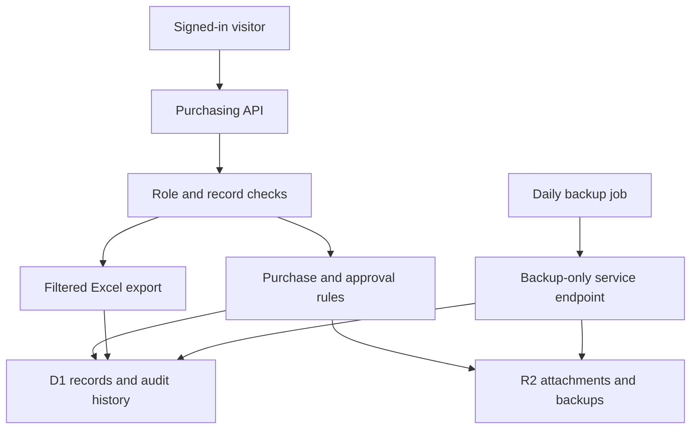

# App architecture

Fuji Purchasing Register is a React application built with Vinext. Sites hosts it as a Cloudflare Worker and supplies sign-in. The app uses D1 for purchasing records and R2 for private files and backups.

## Storage

| D1 table | Purpose |
| --- | --- |
| `app_settings` | Stores the owner’s Site ID, initialization markers, operation locks and service check-ins. |
| `members` | Stores each member’s stable ID, normalized email, linked Site identity, roles, active status and supervisor departments. |
| `purchase_requests` | Stores the purchase document, record version and last update. A new submission uses a requester-specific ID derived from the draft’s submission key so a retry can return the same record. |
| `request_index` | Stores fields used to scope, filter and sort register queries. The register retrieves one page at a time. |
| `audit_events` | Stores dated purchase changes and decisions, including prior proposal snapshots on resubmission. |
| `attachments` | Associates each file with its proposal and records the file name, type, size and optional storage key. R2 holds the contents. Newly uploaded files use the attachment ID as the object key. Restored files use a new R2 object key. |
| `backup_runs`, `backup_rows` | Track backup, verification and restore jobs. Temporary rows hold a consistent copy of the data being processed. |
| `health_checks`, `operation_alerts` | Store observations and alert delivery status when the independent monitoring service is connected. |

The purchase document holds line items, competing quotes, approval steps, order details and file references. Earlier session and authenticator tables remain in the schema for compatibility. Current sign-in uses the hosted identity.

## Identity and record access

The first authorized visitor to a new private workspace becomes its owner. The app matches a new member’s verified email to the entry the owner created and binds it to the member’s Site identity. Role changes preserve that identity and the member’s purchase history. App membership and Site access are separate controls. The hosting audience determines who can visit.

An employee can see their requests. Supervisors have access to assigned departments, while Accounting and senior approval roles have wider visibility. A decision also requires the correct role for the current step. Only the owner can switch to a demo persona, and the server restricts each persona to sample records.

## Consistent writes

- Submission stores a request, its register entry and its audit event together. A retry with the same requester, draft key and content returns that request.
- Updates carry the record version the user last saw. If another user has already changed it, the server rejects the stale update. Only the successful change adds its audit event.
- An attachment upload writes the bytes to R2, then commits metadata and the request update together in D1. If the transaction fails, the app deletes the newly uploaded object.
- Resubmission saves the rejected revision and its approval route in the audit history, then starts the next revision under the original request number.
- The first workspace initialization adds fictional sample records. Later initialization preserves existing requests.

## Dates, exports and files

The app stores audit timestamps as UTC instants and displays them in Eastern time. Order, needed-by, receipt and invoice-forwarded dates are calendar dates. The register evaluates date ranges and overdue status using `America/New_York`.

The Excel export retrieves all matching authorized requests in the selected sort order, across pages, up to 25,000 requests per file. Dates and amounts use spreadsheet date and numeric cells. User-entered text stays literal. Overdue formatting excludes received, rejected and withdrawn requests. Staff enter shipping details manually and record purchase orders placed through Fuji’s existing process.

Each proposal can hold up to ten PDF, JPEG, PNG or plain-text files, each up to 10 MB. The requester or Accounting can attach files to an accessible record. Downloads check the viewer’s access to the associated proposal.

## Backups and monitoring

The daily job runs through a dedicated service endpoint that can start or resume a snapshot for the current Eastern calendar date. D1 stages the purchasing records, audit history, attachment metadata and member directory. The app stores signed manifests, snapshot components and attachment copies in R2. A retry for a completed date returns the same snapshot. The owner can verify its contents and download an encrypted archive.

A restore stages and verifies the backup before replacing purchasing records. The app preserves later audit events, advances record versions and rebuilds the register index. New members recovered from the backup require access review. Existing member privileges stay current.

A separate, optional Worker in `operations/` probes availability and sends alerts to a configured support destination. Workspace tools displays the daily backup check-in separately from the independent monitor. See the [operations guide](operations.md) for setup and the [verification record](verification.md) for release evidence.
