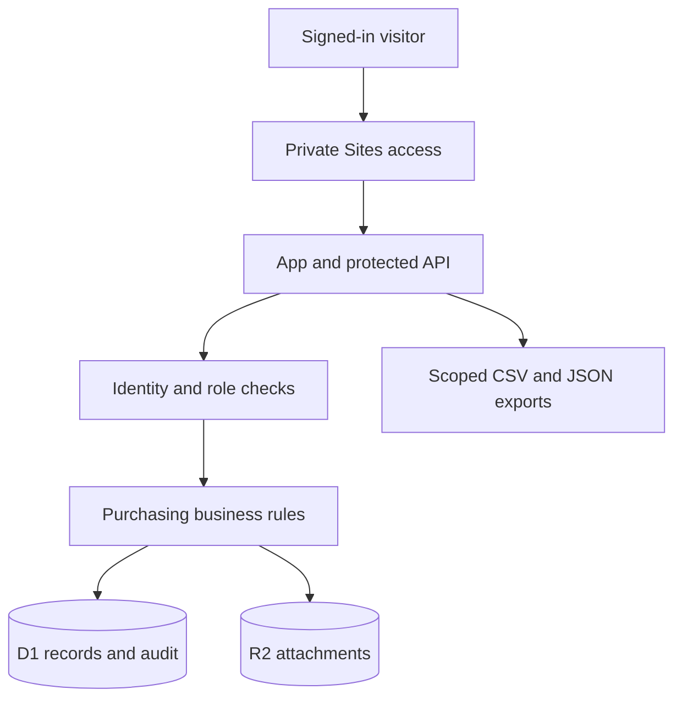

# Architecture and data design

The app is a React/Vinext application deployed as a Cloudflare Worker through Sites. The platform supplies ChatGPT identity and private audience enforcement. The application adds server-side member roles and record-level permissions. D1 stores purchases and audit history; R2 stores private attachments.

## Data model

| Table               | Purpose                                                                                             |
| ------------------- | --------------------------------------------------------------------------------------------------- |
| `app_settings`      | Owner's stable Site user ID and one-time dataset marker                                             |
| `members`           | Stable member ID, unique normalized email, bound Site user ID, roles and supervisor departments     |
| `purchase_requests` | UUID, authoritative JSON document, version number and last-update timestamp                         |
| `audit_events`      | Append-only UUID, proposal ID, dated event document and optional complete prior-version snapshot    |
| `attachments`       | UUID, owning proposal, safe filename, allowed media type and size; contents are keyed by UUID in R2 |

Nested items, comparative quotes, approvals, order details, and attachment references live in the authoritative request JSON. The version column enables atomic optimistic writes. This keeps the course project small while retaining typed, testable business rules.

All IDs used in SQL are bound parameters. Request ownership, totals, decisions and timestamps are assigned or validated on the server. The UI's enabled/disabled state is a convenience, not an authorization boundary.

## Identity and permissions

The owner-private hosting boundary protects first-use ownership registration. The first signed-in authorized visitor is recorded as owner. The owner can configure operational members. A new member first matches their verified sign-in email; that membership then binds to the stable Site user ID. Subsequent role edits preserve the ID and request ownership.

Owner-only demo switching is verified on the server. `x-demo-member` cannot change the authenticated visitor or grant an ordinary member a demo role. Demo actors are additionally restricted to sample records. Workspace membership and hosting audience are separate: adding a member in the app does not send an invitation or change who can visit the Site.

## Consistency

- Updates specify the last observed version and compare it again in the SQL update.
- D1 batches atomically update the document and insert its audit event.
- Audit insertion is conditional on the update's unique mutation ID. A losing concurrent write produces neither a changed proposal nor a spurious event.
- Attachment metadata joins the same conditional batch. A failed database write cleans up its new R2 object.
- Resubmission stores the entire previous proposal in an audit event before resetting approvals for the new revision.
- Schema migrations contain no seed records. Dataset initialization is idempotent and never deletes existing proposals.

## Dates, exports and files

Audit timestamps are ISO UTC instants; the UI displays Eastern time. Order, needed-by, receipt and invoice dates are calendar dates. Date comparisons use `America/New_York`, including around UTC midnight.

CSV cells are quoted and escaped. Strings that could be interpreted as spreadsheet formulas are prefixed with an apostrophe. The byte-order mark helps Excel recognize UTF-8. Numeric money/quantity values retain numeric representations. Records are exported only after the API has filtered them for the effective member.

File uploads accept PDF, JPEG, PNG and text up to 10 MB, with ten files per proposal. Downloads check record access, force an attachment disposition, disable sniffing and avoid public object URLs. No source PDF, signature, access token, local database, or live attachment is committed to GitHub.

## Operational scope

The hosted app is private and persistent. It is an academic implementation with owner-controlled demo personas, documented interpretations of a 2012 policy, and manual shipment entry. It is not connected to Fuji's ERP, supplier ordering, carrier feeds, or email. The code does not present saved order records as actual supplier submissions.
